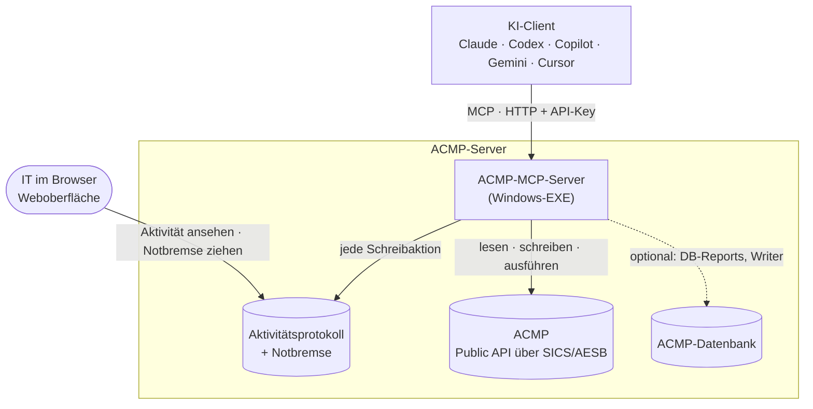

<div align="center">

# ACMP-MCP-Server

**Aagon ACMP für jede KI – mit Aktivitätsprotokoll und Notbremse, direkt auf eurem ACMP-Server.**

[](#kompatibilität)
[](https://modelcontextprotocol.io/)
[](#tools)
[](#weboberfläche)
<br>
[](#kompatibilität)
[](#kompatibilität)
[](LICENSE)
[](https://github.com/Herzog-GmbH/acmp-mcp/commits/main)

[Schnellstart](#schnellstart) · [Client anbinden](#client-anbinden) · [Tools](#tools) · [Sicherheit](#sicherheit) · [Dokumentation](#dokumentation)

</div>

> [!NOTE]
> **English:** MCP server for Aagon ACMP's Public API, with an activity log of every write/execute/delete action and an emergency brake that blocks them all (the four-eyes approval of version 1 is gone). Runs as a single Windows EXE on the ACMP server and works with any MCP client. Docs are in German because ACMP's user base is mostly DACH; issues in English are welcome.

Ein [MCP](https://modelcontextprotocol.io/)-Server für die **ACMP Public API** ([Aagon Client Management Platform](https://www.aagon.com/)). Ihr fragt in normaler Sprache, zum Beispiel „Welche Rechner waren seit 30 Tagen offline?“, und die KI holt sich die Antwort direkt aus ACMP.

## Auf einen Blick

- **Jeder MCP-Client:** Claude, ChatGPT/Codex, GitHub Copilot, Gemini, Cursor …
- **Breite Abdeckung:** Clients, Container, Jobs/Client Commands, Tickets, Assets, Inventar, Schwachstellen und Stammdaten.
- **Aktivitätsprotokoll und Notbremse:** Alles wirkt sofort, vorher zeigt `dryRun` eine Vorschau. Jede Schreib-, Ausführ- und Löschaktion steht mit Bediener, Ziel, Absicht und Ergebnis im Protokoll, und die Notbremse auf der Weboberfläche sperrt sie alle auf einen Klick. Die Vier-Augen-Freigabe von Version 1 gibt es nicht mehr ([warum](#version-2-ohne-vier-augen-freigabe)).
- **Pro Bediener:** eigener API-Key und optional eigene ACMP-Identität. ACMP prüft dann die echten Rechte der Person.
- **Eine EXE, keine Cloud:** läuft direkt auf dem ACMP-Server. Kein IIS, kein .NET-SDK.
- **Lagebild im Browser:** Die Startseite zeigt, was gerade wichtig ist (Rechner ohne Kontakt, volle Platten, alte Scans, Jobs mit vielen Fehlern), dazu eine gemeinsame Liste offener Punkte, den Rollout-Stand eines Client Commands je Rechner und den Fehler-Stopp der Windows-Updates.
- **Optional:** Client Commands anlegen, freigeben, einsortieren und mit Parametern versehen, den **Kiosk** pflegen, **Windows-Updates ablehnen** oder im Testring anhalten, **Managed Software** abonnieren und verteilen, **Container-Filter**, **Wartungsfenster** und **Sicherheitsprofile** setzen, **Unix Scripts** schreiben, **individuelle Felder** anlegen und **Jobs** schalten oder anlegen, direkt in der ACMP-Datenbank. Standardmäßig aus.
- **Fertige Vorlagen:** In der [ACMP CTL](https://herzog-gmbh.github.io/acmp-ctl/) (Community Template Library) liegen Client-Command-Vorlagen mit jedem Schritt im Klartext. `acmp_lib_install` legt sie als Entwurf in eurer Console an.

## Kompatibilität

| | Getestet bzw. vorausgesetzt |
|---|---|
| **ACMP** | 6.9 und 6.10, mit AESB/SICS und freigeschalteter Public API |
| **Schreib-Tools an der Datenbank** (CC-, Kiosk-, WUM-, Unix-Script-, Feld- und Job-Writer) | ACMP 6.10 (Unix Scripts gibt es erst ab 6.10). Bei Abweichungen, etwa nach einem ACMP-Update, sperrt die Vorprüfung das Schreiben |
| **Server** | Windows Server mit .NET Framework 4.8, Admin-Rechte auf dem ACMP-Server |
| **MCP** | Streamable HTTP (JSON-RPC 2.0), Protokollversion `2025-06-18` |
| **KI-Clients** | Vorlagen für Claude Code, Claude Desktop (auch als Erweiterung `.mcpb`), Codex CLI, VS Code/GitHub Copilot, Cursor und Gemini CLI in [`docs/CLIENTS.md`](docs/CLIENTS.md) |

## Schnellstart

### A) Von eurer KI einrichten lassen

Auf dem **ACMP-Server** das Repo klonen oder als ZIP entpacken. Dort einen KI-Agenten starten, der Befehle ausführen kann (Claude Code, Codex CLI, GitHub Copilot im Agent-Modus, Gemini CLI, Cursor o. Ä.), und eingeben:

```text
Richte diesen ACMP-MCP-Server auf diesem Rechner ein. Folge AGENTS.md Schritt für Schritt,
erkläre mir jeden Admin-Schritt, bevor ich ihn ausführe, und frag mich nie nach Passwörtern
oder API-Keys im Chat.
```

[`AGENTS.md`](AGENTS.md) enthält den kompletten Ablauf: Prüfung, Installation, Ersteinrichtung, LAN-Freigabe, Client-Anbindung und Fehlersuche. Die meisten Agenten lesen die Datei von selbst. Für Claude Code (`CLAUDE.md`), Gemini CLI (`GEMINI.md`) und GitHub Copilot (`.github/copilot-instructions.md`) liegen Verweise bei.

### B) Von Hand: der Assistent im Terminal

Auf dem ACMP-Server eine PowerShell öffnen, ins Repo wechseln und starten. Fehlen Admin-Rechte, startet sich das Skript nach einer Windows-Abfrage (UAC) selbst neu:

```powershell
.\install.ps1
```

Zum Schluss zeigt der Assistent **euren API-Key und euren Web-Login** (Kurzname + Web-Token für Übersicht, Aktivität, Notbremse und Onboarding), auf Wunsch kopiert er den Key in die Zwischenablage. Danach fragt er nach eurem KI-Client und zeigt die fertige Konfiguration dafür.

<details>
<summary><b>Was der Assistent in 9 Schritten macht</b></summary>

Bei jedem Schritt erklärt er, was passiert, und schlägt Werte vor (Enter übernimmt):

1. **Prüft die Voraussetzungen** (AESB SICS, Port 3950, .NET, freier Port). Bei einem Fehler sagt er, was zu tun ist.
2. **Fragt nach der Public API** in der ACMP-Konsole und zeigt den Klickpfad.
3. **Installiert und baut** nach `C:\ProgramData\AcmpMcp`. Config, Secrets und Logs sind nur für Administratoren und SYSTEM lesbar.
4. **Fragt den SICS-Benutzer ab.** Das Passwort wird verdeckt eingegeben.
5. **Richtet den Dienst ein und prüft die Anmeldung an ACMP.** Klappt sie nicht, fragt er die Zugangsdaten erneut ab.
6. **Legt dich als ersten Administrator an** (MCP-API-Key und Web-Login).
7. **Verknüpft deine eigene ACMP-Identität**, wenn du das möchtest. Dann prüft ACMP deine echten Rechte.
8. **Optionale Funktionen:** Ad-hoc-PowerShell, DB-Reports, die Schreib-Tools an der Datenbank.
9. **Netzwerk:** schlägt LAN-IP und Subnetz vor und gibt den Server für die Admin-PCs frei.

Die Klicks in der ACMP-Konsole beschreibt [`docs/ACMP-VORBEREITUNG.md`](docs/ACMP-VORBEREITUNG.md), zum Beispiel für die Client-Command-Vorlage der Ad-hoc-PowerShell.

</details>

<details>
<summary><b>Weitere Befehle: Kolleg:innen anlegen, aktualisieren, deinstallieren</b></summary>

Weitere Kolleg:innen legt ihr im Terminal an oder im Browser über `/onboarding`:

```powershell
cd C:\ProgramData\AcmpMcp
.\add-user.ps1
```

| Befehl | Zweck |
|---|---|
| `.\install.ps1 -CheckOnly` | nur prüfen, nichts verändern (kein Admin nötig) |
| `.\install.ps1` | erneut ausführen = aktualisieren. Konfiguration und Bediener bleiben erhalten, Erledigtes wird übersprungen. Eine Config von Version 1 wird dabei umgestellt (`approval` → `web`) |
| `.\install.ps1 -NonInteractive -SicsUser … -AdminName …` | ohne Rückfragen, z. B. für Skripte. Das Passwort kommt aus `$env:ACMP_SICS_PASSWORD` |
| `.\set-network-admin.ps1 -BindAddress <IP>` | Netzwerk später ändern |
| `.\renew-web-tokens.ps1` | Web-Tokens erneuern (alle oder `-Name …`). Die alten gelten danach nicht mehr, die neuen zeigt das Skript nur einmal im Fenster |
| `.\uninstall-admin.ps1` | Dienst und Firewall-Regel entfernen |

</details>

## Client anbinden

Jeder MCP-Client, der **Streamable HTTP** mit eigenem Header kann, verbindet sich direkt:

| | |
|---|---|
| **URL** | `http://<HOST>:8765/` |
| **Header** | `Authorization: Bearer <KEY>` (persönlicher API-Key von der Setup- bzw. Onboarding-Seite) |

Zum Beispiel Claude Code:

```bash
claude mcp add --transport http acmp http://<HOST>:8765/ --header "Authorization: Bearer <KEY>" --scope user
```

**Claude Desktop:** `acmp-mcp-<version>.mcpb` aus den [Releases](https://github.com/Herzog-GmbH/acmp-mcp/releases) per Doppelklick installieren, dann Server-Adresse und API-Key in den Einstellungen der Erweiterung eintragen.

Fertige Konfigurationen für alle gängigen Clients stehen in [`docs/CLIENTS.md`](docs/CLIENTS.md). Clients, die nur lokale (stdio) Server kennen, binden ihr über die Brücke `mcp-remote` an.

## Funktionsweise



<details>
<summary><b>Technische Details</b></summary>

- Der Server verbindet sich über Aagons eigene Client-DLLs (`Aagon.Sis.Sics.*`, sind im ACMP-Setup schon vorhanden) mit SICS/AESB (`wss://127.0.0.1:3950`). Protokoll, Verschlüsselung und Anmeldung sind dadurch dieselben wie in Aagons eigenen Werkzeugen.
- Er sendet ICQL-Kommandos an ACMP. Den Routing-Key ermittelt er selbst, den Virtual Router liest er aus der Config (Standard `VCMN`).
- Die Kommandos stehen als MCP-Tools über JSON-RPC 2.0/HTTP bereit (eigener `TcpListener`, keine URL-ACL nötig).
- **Pro-User:** Jeder Bediener hat einen eigenen API-Key und optional eine eigene ACMP-Identität. ACMP prüft dann dessen echte Rechte (`GetOwnUserRights`).
- **Aktivitätsprotokoll und Notbremse:** Vor jeder Schreib-, Ausführ- oder Löschaktion schreibt der Server einen Eintrag nach `activity-JJJJ-MM.jsonl`. Lässt er sich nicht schreiben, läuft die Aktion nicht. Danach folgt das Ergebnis. Die Notbremse (`notbremse.json`) sperrt alle diese Tools serverseitig, bis ein Mensch sie auf der Weboberfläche löst. Ob ein Aufruf schreibt, entscheidet der Server (Tool-Liste bzw. Kommandoname), nicht das LLM. `dryRun` gilt nur bei Tools, die ihn wirklich auswerten.

</details>

## Version 2: ohne Vier-Augen-Freigabe

Bis Version 1 landeten Schreib-, Ausführ- und Löschbefehle als Antrag auf einer Freigabe-Seite und liefen erst nach Zustimmung. In unserer Praxis wurde nie ein Antrag aus Sicherheitsgründen abgelehnt, die Klicks bremsten nur. Seit Version 2 wirken diese Tools sofort. Dafür gibt es:

- **Vorschau:** Fast alle Schreib-Tools kennen `dryRun: true`. Die Hinweise des Servers weisen die KI an, erst die Vorschau zu zeigen und das OK des Menschen im Chat abzuwarten, bei PowerShell und Löschen immer.
- **Aktivitätsprotokoll:** wer wann was auf welchem Ziel getan hat, mit Absicht und Ergebnis. Kennwörter werden maskiert.
- **Notbremse:** ein Schalter auf der Weboberfläche, der sofort alle Schreib-Tools für alle Bediener sperrt. Lesen und `dryRun` laufen weiter.

**Ein Beispiel im Ablauf:**

1. Ihr schreibt: „Auf PC-0815 ist die Platte voll, räum den Windows-Temp-Ordner auf.“
2. Die KI sucht den Rechner (`acmp_get_client_id`), prüft die Laufwerke (`acmp_low_disk_space`) und zeigt euch das PowerShell-Skript.
3. Nach eurem OK startet sie es (`acmp_run_powershell`). Der Aufruf steht sofort im Aktivitätsprotokoll.
4. Die KI meldet das Ergebnis.

**Update von Version 1:** `git pull` und `.\install.ps1`. Der Assistent stellt die Config um (`approval` → `web`, mit Sicherung). Eure bisherigen Freigabe-Tokens sind danach die Web-Logins. Sie standen aber in den Links der Freigabe-Mails: Erneuert sie danach mit `.\renew-web-tokens.ps1` (als Administrator im Installationsordner). Auch ohne erneute Installation liest der Server eine alte `approval`-Section weiter (nur `publicUrl`, `requester` und `approvers`). Offene Freigabe-Anträge werden nicht mehr ausgeführt.

> [!IMPORTANT]
> Ohne Freigabe hängt die Sicherheit an euren Bedienern und daran, wem ihr API-Keys gebt. Behandelt jeden Key wie ein Domänen-Admin-Passwort, lasst die KI keine Anweisungen aus Tickets, Dateien oder Webseiten ausführen und zieht im Zweifel die Notbremse.

## Tools

179 Tools in 12 Bereichen. Ein Klick auf einen Bereich zeigt alle Tools mit ihrer Wirkung:

🟢 liest · 🟡 schreibt (wirkt sofort, steht im Protokoll) · 🔴 führt aus oder löscht (kritisch). 🟡 und 🔴 sperrt die Notbremse.

Welche Tools etwas ändern, zeigt auch `/settings`. Manche Tools brauchen eine optionale Funktion: *(DB)* die Datenbank-Anbindung (`db.connectionString`, nur lesend), *(PS)* die Client-Command-Vorlage (`runPowershell.clientCommandId`), *(CW)* den CC-Writer (`ccWriter`), *(KW)* den Kiosk-Writer (`kioskWriter`), *(WW)* den WUM-Writer (`wumWriter`), *(UW)* den Unix-Script-Writer (`unixWriter`), *(FW)* den Feld-Writer (`cfWriter`), *(JW)* den Job-Writer (`jobWriter`). Die aktuelle Liste liefert `tools/list`. Jedes Tool akzeptiert optional `format: "json"`.

<details>
<summary><b>System &amp; Allgemein</b> · 16 Tools · Server-Info, eigene Rechte, Server-Jobs, Mail-Warteschlange, offene Punkte, <code>acmp_call</code> für jedes der 167 API-Kommandos</summary>

| | Tool | Zweck |
|---|---|---|
| 🟢 | `acmp_server_info` | ACMP-Version und Serverdaten |
| 🟢 | `acmp_whoami` | mit welchem ACMP-Benutzer und welchen Rechten man arbeitet |
| 🟢 | `acmp_logout` | Verbindung neu aufbauen, z. B. nach einem Token-Wechsel |
| 🟢 | `acmp_list_commands`, `acmp_describe` | alle 167 Public-API-Kommandos auflisten und mit Parametern erklären |
| 🟡 | `acmp_call` | jedes API-Kommando ohne eigenes Tool. Ob es schreibt, entscheidet der Kommandoname (Get…/List… lesen, Delete…/Remove… löschen, sonst schreiben) |
| 🟢 | `acmp_discover_tables` *(DB)* | Tabellen in der ACMP-Datenbank suchen („Was hat mit BitLocker zu tun?“) |
| 🟢 | `acmp_db_columns` *(DB)* | Spalten einer Tabelle oder View |
| 🟢 | `acmp_db_script_rows`, `acmp_db_script_blob` *(beide DB)* | Zeilen und Binärspalten der Client-Command-, Kiosk-, Unix-Script- und File-Repository-Tabellen (nur diese) |
| 🟢 | `acmp_server_jobs` *(DB)* | Aufgaben des ACMP-Servers selbst (Abgleiche, Downloads, Bereinigungen, Berichte) mit letztem Lauf und letzter Fehlermeldung |
| 🟢 | `acmp_mail_queue` *(DB)* | Mails des ACMP-Servers, die in der Warteschlange hängen, mit Fehlermeldung des Mailservers |
| 🟢 | `acmp_console_users` *(DB)* | Benutzer und Gruppen der ACMP-Console mit Rolle, AD-Zuordnung und wer gerade angemeldet ist |
| 🟡 | `acmp_send_report` | einen Bericht der Console sofort erzeugen und per Mail verschicken lassen, nur an Domains aus `reports.allowedMailDomains` |
| 🟢 | `acmp_open_items` | gemeinsame Liste „Offene Punkte“ der IT (steht im Dashboard der Weboberfläche) |
| 🟡 | `acmp_open_item_set` | offenen Punkt anlegen, ändern, erledigen oder wieder öffnen; „von“ ist immer der Bediener des API-Keys |

</details>

<details>
<summary><b>Clients &amp; Inventar</b> · 22 Tools · „Wer war zuletzt an PC-0815?“, Hardware, Akku und TPM, Dienste, Freigaben, individuelle Felder</summary>

| | Tool | Zweck |
|---|---|---|
| 🟢 | `acmp_get_clients`, `acmp_get_client_id`, `acmp_client_info` *(DB)* | Rechner auflisten, ClientId per Computername (über die DB) oder per MachineId und MAC finden, Steckbrief mit IP, MAC und Agent-Version |
| 🟢 | `acmp_get_os_info` | Betriebssystem und zuletzt angemeldeter Benutzer („Wer war zuletzt an PC-0815?“) |
| 🟢 | `acmp_get_hardware`, `acmp_hardware_profile` *(DB)* | CPU, RAM, Platten, Dienste, Hersteller, Modell, Seriennummer |
| 🟢 | `acmp_offline_clients` *(DB)* | Rechner ohne Kontakt seit X Tagen |
| 🟢 | `acmp_agent_versions` *(DB)* | Verteilung der Agent-Versionen |
| 🟢 | `acmp_low_disk_space` *(DB)* | Laufwerke mit wenig freiem Platz |
| 🟡 | `acmp_read_registry`, `acmp_read_registry_result` *(beide PS)* | einen Registry-Wert vom Client lesen (festes Lese-Skript; läuft als Job auf dem Client, deshalb im Protokoll und bei Notbremse gesperrt) |
| 🟢 | `acmp_db_client_attributes` *(DB)* | benutzerdefinierte Felder eines Clients |
| 🟢 | `acmp_cf_list` *(DB)* | individuelle Felder mit Tabelle, Spalte und Typ, auf Wunsch die Werte je Client |
| 🟡 | `acmp_cf_create` *(FW)* | individuelle Felder für Clients anlegen wie in der Konsole (Ganzzahl oder Text, optional neue Tabelle) |
| 🟡 | `acmp_cf_set_value` | Wert eines individuellen Felds bei einem Client setzen wie in der Konsole (Public API, ohne Skriptlauf), mit Prüfung von Länge, Zahlenbereich und Auswahlliste |
| 🟢 | `acmp_os_builds` *(DB)* | Windows-Build mit Revision (UBR) je Client: Ist das kumulative Update wirklich drauf? |
| 🟢 | `acmp_user_logons` *(DB)* | Anmeldungen laut Agent: an welchen Rechnern war eine Person, wer war an einem Rechner |
| 🟢 | `acmp_hardware_health` *(DB)* | Akku-Restkapazität und TPM-Version je Client, schlechteste Akkus zuerst |
| 🟢 | `acmp_services_search` *(DB)* | Windows-Dienste flottenweit: wo ein Dienst läuft, gestoppt oder deaktiviert ist und unter welchem Konto |
| 🟢 | `acmp_shares` *(DB)* | Netzwerkfreigaben der Clients, ohne administrative Freigaben |
| 🟢 | `acmp_windows_features` *(DB)* | optionale Windows-Features flottenweit („Wo ist SMB1 noch aktiv?“) |
| 🔴 | `acmp_delete_clients` | Altlasten aus ACMP entfernen wie „Client löschen“ in der Konsole (höchstens 25, nicht rückgängig). Abgelehnt werden geschützte Clients und Rechner mit Kontakt in den letzten 30 Tagen (außer mit `force`) |

</details>

<details>
<summary><b>Software &amp; Sicherheit</b> · 22 Tools · CVEs, fehlende Updates, Updates ablehnen, Fehler-Stopp im Testring, Defender, BitLocker, Lizenzen</summary>

| | Tool | Zweck |
|---|---|---|
| 🟢 | `acmp_get_software`, `acmp_software_inventory` *(DB)*, `acmp_software_search` *(DB)* | installierte Software je Rechner und Suche („Wo ist 7-Zip drauf?“) |
| 🟢 | `acmp_outdated_software` *(DB)* | veraltete Software |
| 🟢 | `acmp_missing_updates`, `acmp_failed_updates` *(beide DB)* | fehlende und fehlgeschlagene Windows-Updates |
| 🟢 | `acmp_wum_declined` *(DB)* | abgelehnte Windows-Updates mit Kommentar und betroffenen Clients, mit `scope: "open"` die offenen Kandidaten |
| 🟡 | `acmp_wum_decline`, `acmp_wum_restore` *(WW)* | Windows-Updates ablehnen wie in der Konsole bzw. die Ablehnung aufheben, höchstens 10 je Auftrag, mit Pflicht-Kommentar |
| 🟢 | `acmp_wum_update_clients` *(DB)* | welche Clients ein Update (Id, KB-Nummer oder Titel) brauchen, installiert haben oder daran gescheitert sind |
| 🟢 | `acmp_wu_diagnosis` *(DB)* | Registry-Prüfung der Update-Verwaltung: fehlende WSUS-Richtlinien, pausierte Updates, Windows Update for Business |
| 🟢 | `acmp_wum_rings` *(DB)* | Verteilungsringe mit Fehler-Stopp: je Update im Testring der Stand auf den Testrechnern, geplante Weitergabe, Grund eines Stopps |
| 🟡 | `acmp_wum_ring_hold` *(WW)* | Update im Testring anhalten (automatischer Übergang aus) |
| 🔴 | `acmp_wum_ring_release` *(WW)* | angehaltenes Update weiterlaufen lassen oder sofort freigeben (Notfall bei kritischen Lücken) |
| 🟢 | `acmp_security_profiles` *(DB)* | BitLocker- und Defender-Konfigurationsprofile von ACMP, ihre Container und Einstellungen |
| 🟢 | `acmp_vulnerabilities`, `acmp_oval_scan_status` *(beide DB)* | Schwachstellen (CVEs) mit Score und Zeitpunkt des letzten Scans |
| 🟢 | `acmp_oval_definitions` *(DB)* | flottenweite Suche in den OVAL-Definitionen nach CVE oder Produkt („Kennt ACMP die CVE schon, und wer ist betroffen?“), mit Hinweis, wie viele Clients seit Veröffentlichung gescannt wurden |
| 🟢 | `acmp_defender_health` *(DB)* | Defender-Status („Wo ist der Echtzeitschutz aus?“) |
| 🟢 | `acmp_bitlocker_status` *(DB)* | BitLocker-Status je Laufwerk |
| 🟢 | `acmp_get_licenses`, `acmp_license_compliance` *(DB)* | Lizenzen mit Über- und Unterdeckung |

Der Fehler-Stopp hält ein Update im Testring an, wenn es auf einem Testrechner mit einem echten Fehler scheitert oder kurz vor der Weitergabe noch auf keinem Testrechner installiert ist. Auf Wunsch prüft das ein Wächter im Server stündlich und meldet per Mail (`wumWatch`, standardmäßig aus). Regeln: [`docs/USAGE.md`](docs/USAGE.md#fehler-stopp-der-windows-updates).

</details>

<details>
<summary><b>Managed Software</b> · 6 Tools · Abos, Versionen je Ring, Verteilung in der Flotte, Testinstallation</summary>

| | Tool | Zweck |
|---|---|---|
| 🟢 | `acmp_msw_packages` *(DB)* | abonnierte Pakete (oder der ganze Katalog) mit neuester und freigegebener Version, Clients mit dem Paket und mit offenem Update, Daueraufträgen |
| 🟢 | `acmp_msw_package` *(DB)* | ein Paket im Detail: Versionen je Verteilungsring, Versionsverteilung in der Flotte, Daueraufträge, Parameter |
| 🟢 | `acmp_msw_client` *(DB)* | Managed-Software-Stand eines Clients mit den letzten Läufen |
| 🟡 | `acmp_msw_subscribe` *(JW)* | Pakete abonnieren wie in der Konsole; Herunterladen und Freigabe erledigt der ACMP-Server |
| 🔴 | `acmp_msw_job_create` *(JW)* | Dauerauftrag für ein Paket an einem Container anlegen (installieren/aktualisieren oder nur aktualisieren) |
| 🔴 | `acmp_msw_test_install` *(JW)* | Paket einmalig an 1–5 Clients geben wie „Managed Software zuweisen“, z. B. für einen Test |

Die Public API kann Managed Software nicht verteilen. Die Schreib-Tools gehören zum Job-Writer und brauchen zusätzlich `grant-msw-writer.sql`. Den sofortigen Anstoß an die Agents kann der MCP nicht auslösen: Ein Agent holt den Auftrag bei seiner nächsten Job-Abfrage.

</details>

<details>
<summary><b>Jobs &amp; Ausführen</b> · 20 Tools · Daueraufträge prüfen, schalten und anlegen, Schritt-Protokoll, Wartungsfenster, Agentenplaner, PowerShell als SYSTEM 🔴</summary>

| | Tool | Zweck |
|---|---|---|
| 🟢 | `acmp_get_client_commands` | verfügbare Client Commands |
| 🟢 | `acmp_get_jobs`, `acmp_job_results`, `acmp_script_history` *(alle DB)* | welche Jobs ein Rechner hat, was auf ihm gelaufen ist und mit welchem Ergebnis |
| 🟢 | `acmp_jobs` *(DB)* | Daueraufträge (Jobs an Containern) mit Ziel, Startbedingung im Klartext, Läufen und Fehlern der letzten 7 und 30 Tage und Hinweisen („Welche Jobs laufen stündlich ohne ‚einmalig‘?“) |
| 🟢 | `acmp_agent_tasks`, `acmp_scanner_status`, `acmp_maintenance_windows` *(alle DB)* | Agentenplaner-Aufgaben (Scanner) mit Startbedingung und Containern, letzte Daten je Client und Scanner, Wartungsfenster |
| 🟡 | `acmp_job_set_enabled`, `acmp_job_restore` *(JW)* | Daueraufträge ab- und wieder einschalten wie in der Konsole, jede Job-Änderung aus der Sicherung zurücknehmen |
| 🔴 | `acmp_job_set_condition` *(JW)* | Startbedingung eines Containers setzen (einmalig, beim Agentenstart, täglich, stündlich, im Wartungsfenster). Gilt für alle seine Daueraufträge |
| 🔴 | `acmp_job_delete` *(JW)* | Daueraufträge löschen wie in der Konsole, Job-Historie und Job-Vorlage bleiben; einmalige Jobs wie „Löschen“ im Job-Monitor |
| 🔴 | `acmp_job_create` *(JW)* | Client Command (ohne Parameter) als Dauerauftrag an einem Container anlegen |
| 🟢 | `acmp_job_log` *(DB)* | Schritt-Protokoll eines Client-Command-Laufs: jeder Schritt mit Ergebnis, Dauer und Meldungen |
| 🟡 | `acmp_maintenance_window_create` *(JW)* | Wartungsprofil (Zeitfenster je Wochentag) anlegen wie in der Konsole |
| 🔴 | `acmp_maintenance_window_assign`, `acmp_maintenance_window_delete` *(JW)* | Wartungsprofil einem Container zuordnen oder entziehen, ungenutztes Profil löschen |
| 🔴 | `acmp_agent_template_assign` *(JW)* | Agentenplaner-Vorlage einem Container zuordnen oder entziehen |
| 🔴 | `acmp_enqueue_client_command` | einen vorhandenen Client Command starten |
| 🔴 | `acmp_run_powershell` *(PS)* | beliebiges PowerShell als SYSTEM auf einem Client |

Jobs ändern kann die Public API nicht. Die Job-Schreib-Tools schreiben deshalb direkt in die ACMP-Datenbank und sind standardmäßig aus. Höchstens 10 Jobs je Auftrag, vorher wird gesichert, `acmp_job_restore` nimmt jede Änderung zurück. Einrichtung: [`docs/ACMP-VORBEREITUNG.md`](docs/ACMP-VORBEREITUNG.md#weitere-schreib-tools-windows-updates-unix-scripts-individuelle-felder-jobs) → „Weitere Schreib-Tools“.

</details>

<details>
<summary><b>Client Commands</b> · 20 Tools · <i>optional</i> · Entwurf anlegen, neue Version, Parameter, freigeben, einsortieren, löschen</summary>

Die Public API kann Client Commands nur starten, nicht anlegen. Diese Tools lesen sie deshalb direkt aus der ACMP-Datenbank, legen auf Wunsch **Entwürfe** an, geben eigene Entwürfe frei und sortieren Commands in Ordner. Das Schreiben ist von Aagon nicht vorgesehen und deshalb standardmäßig aus. Einrichtung: [`docs/ACMP-VORBEREITUNG.md`](docs/ACMP-VORBEREITUNG.md#client-commands-direkt-schreiben-cc-writer) → „Client Commands direkt schreiben“.

| | Tool | Zweck |
|---|---|---|
| 🟢 | `acmp_cc_decode` *(DB)* | Schritte eines Client Commands im Klartext, als Eingabe für einen neuen Entwurf verwendbar. Kennwörter werden maskiert |
| 🟢 | `acmp_cc_catalog` *(DB)* | welche Schrittarten in euren Commands vorkommen, mit Feldern und Beispielen |
| 🟢 | `acmp_cc_folders` *(DB)* | Ordnerbaum der Client Commands, auf Wunsch mit den Commands je Ordner |
| 🟢 | `acmp_cc_writer_status` *(DB)* | Stand des Writers und Ergebnis der Kompatibilitätsprüfung |
| 🟡 | `acmp_cc_create_draft`, `acmp_cc_update_draft` *(CW)* | Entwurf anlegen oder seine Schritte ersetzen (vorher automatische Sicherung) |
| 🟡 | `acmp_cc_restore_draft` *(CW)* | Entwurf auf eine Sicherung zurücksetzen |
| 🟡 | `acmp_cc_add_file`, `acmp_cc_remove_file` *(CW)* | Installationsdatei an einen Entwurf hängen oder entfernen (File Repository, mit SHA-256) |
| 🟡 | `acmp_cc_new_version` *(CW)* | neue Version eines vorhandenen Commands als Entwurf, auch von freigegebenen und fremden (wie „Speichern“ in der Konsole). Die freigegebene Version läuft weiter, bis die neue freigegeben ist (`acmp_cc_release` oder Konsole). Die Vorschau (`dryRun`) zeigt die Änderungen gegenüber der freigegebenen Version |
| 🟡 | `acmp_cc_release` *(CW)* | Entwürfe freigeben wie in der Konsole, mehrere in einem Auftrag: eigene neue Commands und neue Versionen aus `acmp_cc_new_version` (die bisher freigegebene Version wird dabei abgelöst). Erst `dryRun`, die Vorschau zeigt jeden Command |
| 🟢 | `acmp_cc_parameters` *(DB)* | Parameter eines Commands (Text, Auswahl, Kontrollkästchen), die ACMP beim Job und im Kiosk abfragt |
| 🟡 | `acmp_cc_set_parameters` *(CW)* | Parameter setzen wie der Dialog in der Konsole, wirkt ohne neue Version |
| 🟡 | `acmp_cc_move` *(CW)* | viele Commands in einem Auftrag in andere Ordner verschieben, mit `undo` |
| 🟡 | `acmp_cc_add_folder`, `acmp_cc_update_folder` *(CW)* | Ordner anlegen (Rechte wie der Elternordner), umbenennen oder verschieben |
| 🟢 | `acmp_lib_search` | Vorlagen in der [ACMP CTL](https://herzog-gmbh.github.io/acmp-ctl/) oder einem eigenen Vorlagen-Ordner suchen, mit Parametern und Voraussetzungen |
| 🟡 | `acmp_lib_install` *(DB, CW)* | Vorlage aus der [ACMP CTL](https://herzog-gmbh.github.io/acmp-ctl/) (Community Template Library) oder einem eigenen Vorlagen-Ordner als Entwurf installieren. Mit `dryRun` 🟢 auch ohne Writer |
| 🔴 | `acmp_cc_delete` *(JW)* | Client Command mit allen Versionen löschen wie in der Konsole. Abgelehnt: Commands mit Daueraufträgen, in Aagon-Standardordnern, in der Konsole geöffnet, die Vorlagen des MCP selbst |
| 🔴 | `acmp_cc_delete_folder` *(JW)* | leeren Client-Command-Ordner samt leerer Unterordner löschen |

Der Writer ändert nur eigene Entwürfe im erlaubten Ordner und nur für erlaubte Bediener. Vorhandene Commands fasst er nur über `acmp_cc_new_version` an: als neue Version, nie in Aagon-Standardordnern, Schritt-IDs und gespeicherte Kennwörter bleiben erhalten, einen fremden Entwurf überschreibt er nur auf ausdrücklichen Wunsch (mit Sicherung). Die Vorschau (`dryRun`) zeigt jeden Schritt mit seinen Feldern.

Vor dem Schreiben prüft der Server die ACMP-Version, Tabellen, Trigger und Rechte des Schreib-Logins. Er packt außerdem die 50 neuesten Commands probeweise aus und wieder ein. Weicht etwas ab, etwa nach einem ACMP-Update, schreibt er nichts. Freigeben geht für eigene Entwürfe und für Versionen, die zuletzt der MCP gespeichert hat. Folgeversionen mit geänderten Dateien gibt er nicht frei, die bleiben Sache der Konsole. Platzhalter wie „HIER … EINTRAGEN“ sperren die Freigabe. Getestet mit ACMP 6.10.

</details>

<details>
<summary><b>Kiosk</b> · 13 Tools · <i>optional</i> · Einträge, Ordner, Sichtbarkeit, Icons</summary>

Auch den ACMP-Kiosk kann die Public API nicht pflegen. Diese Tools lesen und schreiben ihn deshalb direkt in der ACMP-Datenbank. Auch das ist standardmäßig aus. Einrichtung: [`docs/ACMP-VORBEREITUNG.md`](docs/ACMP-VORBEREITUNG.md#kiosk-pflegen-kiosk-writer) → „Kiosk pflegen“.

| | Tool | Zweck |
|---|---|---|
| 🟢 | `acmp_kiosk_tree` *(DB)* | Kiosk-Ordner, Einträge und Sichtbarkeitsfilter im Klartext; mit `status: true` das Ergebnis der Vorprüfung |
| 🟢 | `acmp_kiosk_images` *(DB)* | vorhandene Icons und Bilddateien in den erlaubten Quellen, mit Vorschau im Chat |
| 🟡 | `acmp_kiosk_add_item` *(KW)* | Client Command oder Managed Software als Kiosk-Eintrag anlegen, mit Icon und Sichtbarkeitsfilter (AD-Gruppe, OU, Benutzer, Container, Stammdaten …) |
| 🟡 | `acmp_kiosk_update_items` *(KW)* | viele Einträge in einem Auftrag verschieben, umbenennen, Beschreibung, Icon oder Filter ändern |
| 🟡 | `acmp_kiosk_set_filter`, `acmp_kiosk_remove_item` *(KW)* | Sichtbarkeit eines Eintrags ändern, Eintrag entfernen |
| 🟡 | `acmp_kiosk_add_group`, `acmp_kiosk_update_group` *(KW)* | Kiosk-Ordner anlegen, umbenennen (DE/EN), Icon und Filter ändern |
| 🟡 | `acmp_kiosk_add_image`, `acmp_kiosk_set_image`, `acmp_kiosk_remove_image` *(KW)* | Icon hochladen (PNG, JPG, ICO, SVG), setzen, ungenutztes eigenes Icon entfernen |
| 🟡 | `acmp_kiosk_restore` *(KW)* | eine Kiosk-Änderung aus der automatischen Sicherung zurückholen |
| 🔴 | `acmp_kiosk_delete_group` *(JW)* | leeren Kiosk-Ordner löschen |

Geschrieben wird nur in Kiosk-Ordnern, die ihr freigebt, und in Ordnern, die der MCP selbst angelegt hat. Vor jeder Änderung sichert der Server den alten Stand. Die Anwender sehen Änderungen nach „Aktualisieren“ im Kiosk.

</details>

<details>
<summary><b>Unix Scripts</b> · 6 Tools · <i>optional</i> · Bash/Zsh für Linux und macOS, Ausgaben je Client</summary>

Unix Scripts (ACMP 6.10, Desktop Automation) laufen über den ACMP Unix Agent als root auf Linux- und macOS-Clients. Auch sie kann die Public API nicht anlegen. Das Schreiben ist standardmäßig aus. Einrichtung: [`docs/ACMP-VORBEREITUNG.md`](docs/ACMP-VORBEREITUNG.md#weitere-schreib-tools-windows-updates-unix-scripts-individuelle-felder-jobs) → „Weitere Schreib-Tools“.

| | Tool | Zweck |
|---|---|---|
| 🟢 | `acmp_unix_scripts` *(DB)* | Skripte mit Ordner, Interpreter und freigegebener Version, auf Wunsch alle Versionen mit Verteilungsring und Inhalt |
| 🟢 | `acmp_unix_results` *(DB)* | Läufe je Client aus dem Job-Monitor mit der vollständigen Ausgabe (StdOut/StdErr) |
| 🟡 | `acmp_unix_script_create` *(UW)* | neues Skript anlegen, Version 1 in Testring 1 |
| 🟡 | `acmp_unix_script_new_version` *(UW)* | neue Version anlegen, die Vorschau zeigt die geänderten Zeilen |
| 🟡 | `acmp_unix_script_set_ring` *(UW)* | Verteilungsring einer Version ändern, `ring: 255` gibt sie frei |
| 🔴 | `acmp_unix_script_delete` *(JW)* | Skript mit allen Versionen löschen wie in der Konsole, bisherige Ausgaben bleiben |

Vorhandene Versionen ändert der MCP nicht, löschen geht nur für das ganze Skript. Einen Unix-Job **starten** kann er nicht, weil ACMP dafür weder API noch Job Collection hat: Das macht ihr in der Konsole (Container oder Abfrage → „Unix-Jobs ausführen“), das Ergebnis liest danach `acmp_unix_results`. Ohne freie Unix-Script-Lizenz meldet ACMP den Job als „Erfolg“, das Skript läuft aber nicht. `acmp_unix_results` weist darauf hin.

</details>

<details>
<summary><b>Container</b> · 9 Tools · Mitglieder und Filter lesen, anlegen, ändern, Sicherheitsprofile, löschen 🔴</summary>

| | Tool | Zweck |
|---|---|---|
| 🟢 | `acmp_container_members`, `acmp_client_containers` *(beide DB)* | Rechner in einem Container und Container eines Rechners |
| 🟡 | `acmp_create_container`, `acmp_save_containers` | Container anlegen oder ändern |
| 🟡 | `acmp_container_set_restriction` *(JW)* | Client-Beschränkung eines Containers: nur Clients seiner Betriebssystemfamilie oder alle |
| 🟢 | `acmp_container_filter` *(DB)* | dynamischer Filter eines Containers lesbar (Verknüpfung, Kriterien, Untergruppe), wie viele Rechner er gerade trifft, ob der MCP ihn ändern kann |
| 🔴 | `acmp_container_set_filter` *(JW)* | Filter eines Containers setzen wie in der Konsole; die Vorschau nennt die Rechner, die dazukommen oder wegfallen. Einzelne Rechner ausschließen mit `excludeComputers` |
| 🔴 | `acmp_container_security_profile` *(JW)* | BitLocker- oder Defender-Profil einem Container zuordnen oder entziehen. Die Agents setzen es auf allen Mitgliedern um |
| 🔴 | `acmp_delete_containers` | Container löschen |

</details>

<details>
<summary><b>Assets &amp; Stammdaten</b> · 25 Tools · Assets verleihen, Kontakte, Standorte, Verträge</summary>

| | Tool | Zweck |
|---|---|---|
| 🟢 | `acmp_get_asset_list`, `acmp_get_asset_types` | Assets und Asset-Typen |
| 🟡 | `acmp_create_asset`, `acmp_update_asset` | Asset anlegen oder ändern |
| 🟡 | `acmp_lend_asset`, `acmp_return_asset` | Asset verleihen oder zurücknehmen |
| 🟢 | `acmp_get_contacts`, `_companies`, `_locations`, `_departments`, `_cost_centers` | Stammdaten lesen |
| 🟡 | `acmp_create_*`, `acmp_update_*` für `contact`, `company`, `location`, `department` | Stammdaten anlegen oder ändern |
| 🟢 | `acmp_get_contracts`, `acmp_contracts_expiring` *(DB)* | Verträge und bald auslaufende Verträge |
| 🟢 | `acmp_get_custom_fields`, `_custom_field_list`, `_master_data_settings`, `_app_settings` | Zusatzfelder und Einstellungen lesen |

</details>

<details>
<summary><b>Helpdesk</b> · 18 Tools · „Mach ein Ticket: Drucker 2. OG druckt nicht.“</summary>

| | Tool | Zweck |
|---|---|---|
| 🟢 | `acmp_get_tickets`, `acmp_get_ticket`, `acmp_tickets_by_query` | Tickets lesen, auch über gespeicherte Abfragen |
| 🟢 | `acmp_get_ticket_comments`, `_worktime`, `_costs`, `acmp_get_linked_tickets` | Verlauf, Zeiten, Kosten, Verknüpfungen |
| 🟢 | `acmp_helpdesk_settings`, `acmp_get_assignees`, `_ticket_templates`, `_ticket_categories`, `_ticket_resolutions`, `_queries` | Helpdesk-Einstellungen |
| 🟡 | `acmp_create_ticket` | Ticket anlegen („Mach ein Ticket: Drucker 2. OG druckt nicht.“) |
| 🟡 | `acmp_update_ticket` | Bearbeiter oder Priorität ändern |
| 🟡 | `acmp_close_ticket`, `acmp_reopen_ticket` | Ticket schließen oder wieder öffnen |
| 🟡 | `acmp_add_ticket_comment` | Kommentar ergänzen |

</details>

<details>
<summary><b>Fernwartung</b> · 2 Tools · TeamViewer-ID und Verbindungslink</summary>

| | Tool | Zweck |
|---|---|---|
| 🟢 | `acmp_teamviewer_ids` *(DB)* | TeamViewer-IDs aller Clients |
| 🟢 | `acmp_teamviewer_connect` *(DB)* | TeamViewer-Link zu einem Rechner, Suche auch per Benutzername |

</details>

Beispiel-Prompts stehen in [`docs/USAGE.md`](docs/USAGE.md). Neue native Kommandos ergänzt ihr deklarativ in `api-tools.json`, neue SQL-Reports in `db-tools.json`. Beides braucht kein Neu-Kompilieren.

## Weboberfläche

| Seite | Zweck |
|---|---|
| `/dashboard` | Lagebild: was gerade wichtig ist (Rechner ohne Kontakt, wenig Platz, alte Scans, Jobs mit vielen Fehlern, Server-Jobs), offene Punkte mit Formular, Notbremse und letzte Aktivität. Braucht `db.connectionString`, Schwellen in `dashboard` |
| `/dashboard/rollout` | Rollout-Stand eines Client Commands je Rechner: Auftrag, letzter Lauf, Ergebnis, Kennzeilen aus der Ausgabe |
| `/dashboard/updates` | Fehler-Stopp der Windows-Updates: angehaltene Updates mit Entscheidung (weiterlaufen lassen, sofort freigeben), Stand je Testrechner, Meldungen |
| `/activity` | Aktivitätsprotokoll mit Filter nach Bediener, Tool und Fehlern |
| `/settings` | Notbremse ziehen und lösen, Bediener mit Web-Zugang, alle Tools, die etwas ändern |
| `/onboarding` | weitere Bediener anlegen |
| `/changelog` | Patchverlauf des Servers |
| `/setup` | Ersteinrichtung, nur aktiv, solange es keinen Bediener mit Web-Zugang gibt |

Die Anmeldung (`/login`) läuft über Kurzname und ein eigenes Web-Token pro Bediener, danach über ein Sitzungs-Cookie (HttpOnly, SameSite=Strict, 12 Stunden). Das Web-Token ist **unabhängig** vom ACMP- oder MCP-Key: Mit einem abgeflossenen API-Key lässt sich die Notbremse nicht lösen. Alte Links aus Version 1 (`?approver=…&token=…`) melden nicht mehr an, denn ein Token in der Adresse landet in Mails, Browserverlauf und Proxy-Logs. `renew-web-tokens.ps1` erneuert die Web-Tokens.

## Konfiguration

`config.example.json` ist kommentiert (`_hinweis`-Felder). `install.ps1` erzeugt daraus `config.local.json`.

<details>
<summary><b>Wichtige Schlüssel</b></summary>

| Schlüssel | Bedeutung |
|---|---|
| `sics.username` / `password` | SICS-/AESB-Basisverbindung |
| `sics.virtualRouter` / `wssPort` | Standard `VCMN` / `3950` |
| `mcp.bindAddress` / `httpPort` | Standard `127.0.0.1` / `8765`. LAN-Zugriff über `set-network-admin.ps1` |
| `web.publicUrl` / `web.users` | Adresse der Weboberfläche (auch für den Rückkanal von `acmp_read_registry`) und Bediener mit Web-Zugang |
| `runPowershell.clientCommandId` | optional, aktiviert `acmp_run_powershell` / `acmp_read_registry` |
| `runPowershell.protectedClients` / `protectedClientIds` | optional: weitere Rechner (Computernamen bzw. ClientIds), auf denen der MCP keine Jobs startet. Der ACMP-/MCP-Server selbst ist immer dabei. Ohne DB-Anbindung setzt ihr `protectedClientIds` (ClientId des ACMP-Servers), sonst lehnt der Server Jobs auf Clients ab |
| `db.connectionString` | optional, aktiviert die DB-Report-Tools |
| `helpdesk.createdStateId` | optional, Ticketstatus für neue Tickets |
| `ccWriter.*` | optional, standardmäßig aus: Client Commands als Entwurf schreiben, freigeben, einsortieren. Einrichten mit `setup-cc-writer.ps1`, weitere Bediener mit `setup-cc-writer.ps1 -AddRequester <name>` |
| `kioskWriter.*` | optional, standardmäßig aus: Kiosk pflegen. Setzt den CC-Writer voraus (gleicher SQL-Login). Einrichten mit `setup-kiosk-writer.ps1` |
| `wumWriter.*`, `unixWriter.*`, `cfWriter.*`, `jobWriter.*` | optional, standardmäßig aus: Windows-Updates ablehnen und im Testring anhalten, Unix Scripts schreiben, individuelle Felder anlegen, Jobs schalten und anlegen, Managed Software, Container-Filter, Wartungsfenster, Sicherheitsprofile, Löschen. Setzen den CC-Writer voraus (gleicher SQL-Login und Bediener). Einrichten mit `setup-extra-writers.ps1` |
| `wumWatch.*` | optional, standardmäßig aus: Wächter des Fehler-Stopps (`mode: report` meldet nur, `hold` hält auch an), Sammel-Mail über `mail.smtpHost` |
| `reports.allowedMailDomains` | optional: Domains, an die `acmp_send_report` Berichte schicken darf. Leer = Tool aus |
| `dashboard.*` | optional: Schwellen des Lagebilds (Tage ohne Kontakt, freier Platz, Scan-Alter, Fehlerquote der Jobs) |
| `ctl.sources` | optional, Quellen für `acmp_lib_install`. Standard: Ordner `ctl` im Installationsordner, dann das Repo [`Herzog-GmbH/acmp-ctl`](https://github.com/Herzog-GmbH/acmp-ctl) |

</details>

## Sicherheit

> [!WARNING]
> Der Server gewährt vollen ACMP-Zugriff bis hin zur **Befehlsausführung auf allen Endgeräten**. Behandelt jeden API-Key wie ein Admin-Passwort.

- **Kein TLS eingebaut.** Der Server lauscht standardmäßig nur auf `127.0.0.1` und verweigert LAN-Betrieb ohne API-Key. Im LAN beschränkt ihr per Firewall die Quell-Subnetze. Über Netzgrenzen hinweg gehört ein TLS-Proxy oder VPN davor.
- `install.ps1` beschränkt den Installationsordner auf Administratoren und SYSTEM, denn dort liegen Zugangsdaten.
- **Notbremse und Protokoll** liegen im Installationsordner (`notbremse.json`, `activity-*.jsonl`). Wer dort schreiben kann, kann beides umgehen, deshalb nur Administratoren und SYSTEM. Auf dem ACMP-/MCP-Server selbst startet der MCP keine Jobs (`acmp_run_powershell`, `acmp_enqueue_client_command`, `acmp_read_registry`, `acmp_call`), denn ein Skript als SYSTEM könnte dort `config.local.json` mit allen Keys lesen. Weitere Rechner, etwa den SQL-Server, schützt ihr mit `runPowershell.protectedClients`.
- Bediener-Passwörter werden nie gespeichert: `acmp-token-setup.exe` speichert nur einen DPAPI-verschlüsselten Token (`LocalMachine`).
- `/regresult` (Rückkanal für `acmp_read_registry`) ist bewusst ohne Key erreichbar, weil der Client den Key nicht kennt. Er nimmt nur Ergebnisse zu offenen, nicht ratbaren Tokens an.
- Sicherheitslücken bitte **nicht** als öffentliches Issue melden, sondern wie in [`SECURITY.md`](SECURITY.md) beschrieben.

<details>
<summary><b>Schreib-Tools an der Datenbank</b></summary>

- Der optionale CC-Writer schreibt mit einem **eigenen SQL-Login** mit genau den nötigen Rechten (`grant-cc-writer.sql`), nie mit dem Lese-Zugang. Mit diesen Rechten allein darf er in `SYS_SCRIPTS` nichts löschen. Er legt nur Entwürfe an, sichert vor jeder Änderung und ändert oder gibt nur Commands frei, die er selbst angelegt hat. Fremde Commands ändert er nur als neue Version (`acmp_cc_new_version`) und verschiebt sie auf Wunsch.
- Der optionale Kiosk-Writer nutzt denselben Login mit den Rechten aus `grant-kiosk-writer.sql` und schreibt nur in freigegebene Kiosk-Ordner.
- WUM-, Unix-Script-, Feld- und Job-Writer nutzen ebenfalls diesen Login (`grant-wum-writer.sql`, `grant-unix-writer.sql`, `grant-cf-params.sql`, `grant-jobs-writer.sql`). Updates lehnt der Server nur über die ACMP-eigene Prozedur ab. Für individuelle Felder bekommt der Login **keine** DDL-Rechte: Tabellen und Spalten legen zwei Prozeduren an, die nur genau das Muster des ACMP-Servers bauen. In `SYS_Jobs` darf der Login nur Startbedingung und Prüfsumme ändern; Jobs löscht er über die Verknüpfung zur Job-Vorlage, den Rest erledigt der ACMP-Trigger.
- **Löschen** (Client Commands, leere CC- und Kiosk-Ordner, Unix Scripts, Wartungsprofile) und Wartungsfenster, Sicherheitsprofile und Agentenplaner-Vorlagen gehen erst mit den zusätzlichen Rechten aus `grant-luecken-writer.sql`. Jedes dieser Tools sichert vorher und nachher alle betroffenen Zeilen in einer Transaktion und legt sie mit `acmp_job_restore` zurück, solange niemand sie inzwischen geändert hat. Ohne das Skript bleiben genau diese Tools gesperrt.
- Wichtig für das Onboarding: Der SQL-Login gehört dem **Server**, nicht den Bedienern. Wer die Schreib-Tools nutzen darf, steht in `ccWriter.allowedRequesters` (`add-user.ps1` fragt danach, für Bediener aus `/onboarding`: `setup-cc-writer.ps1 -AddRequester <name>`). Die ACMP-Rechte der Person prüft ACMP bei diesen Tools **nicht**, weil sie an der Public API vorbei in die Datenbank schreiben.

</details>

## Dokumentation

| Datei | Inhalt |
|---|---|
| [`AGENTS.md`](AGENTS.md) | Einrichtungs-Ablauf für KI-Agenten, inkl. Fehlersuche |
| [`docs/ACMP-VORBEREITUNG.md`](docs/ACMP-VORBEREITUNG.md) | Klicks in der ACMP-Konsole: Public API, SICS-Benutzer, optionale Funktionen |
| [`docs/CLIENTS.md`](docs/CLIENTS.md) | Konfiguration für alle gängigen MCP-Clients |
| [`docs/USAGE.md`](docs/USAGE.md) | Cheat-Sheet mit Beispiel-Prompts für Anwender |
| [`config.example.json`](config.example.json) | kommentierte Beispiel-Konfiguration |
| [`SECURITY.md`](SECURITY.md) | Sicherheitslücken vertraulich melden |

## Mitmachen

Issues und Pull Requests sind willkommen. Bitte in Issues **keine** Logs mit Hostnamen, IPs, Benutzernamen, Keys oder Tokens posten, sondern vorher schwärzen.

## Lizenz

[MIT](LICENSE). Kein offizielles Produkt der Aagon GmbH. ACMP und AESB sind Marken der Aagon GmbH.
