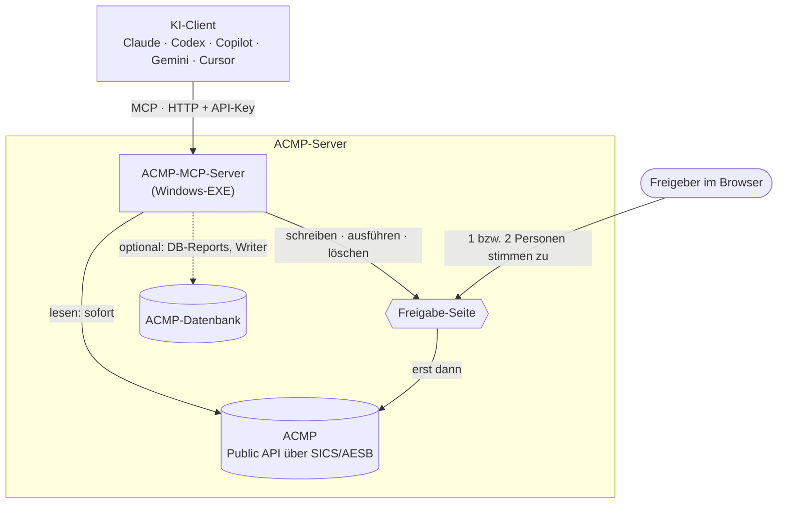
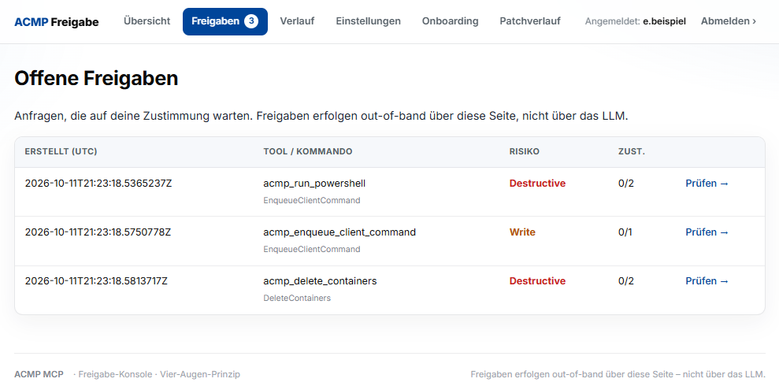
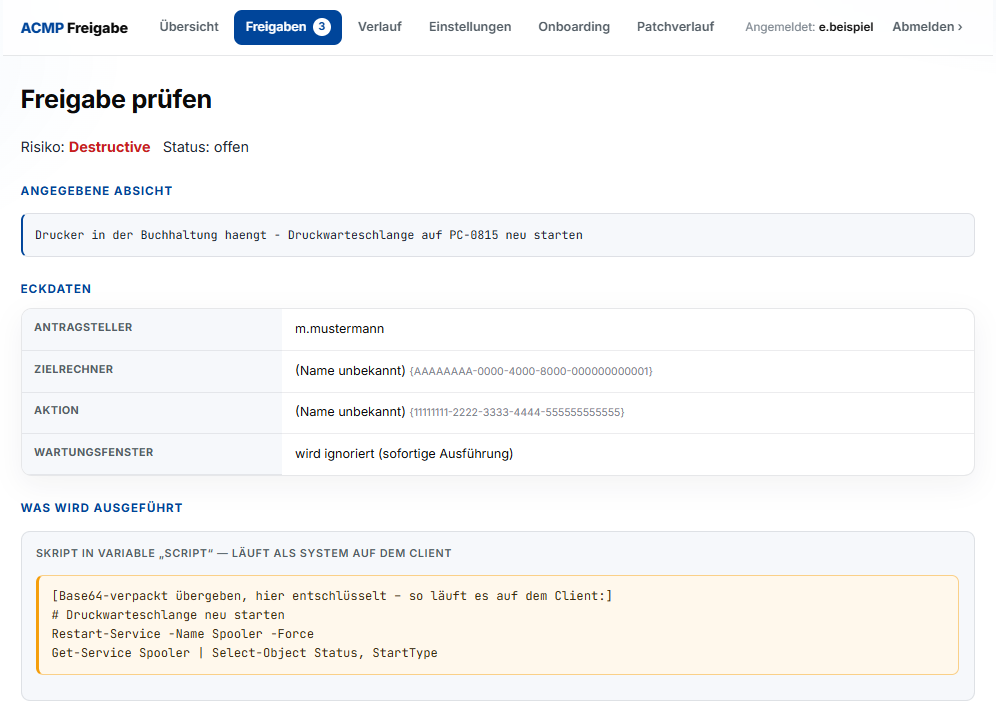
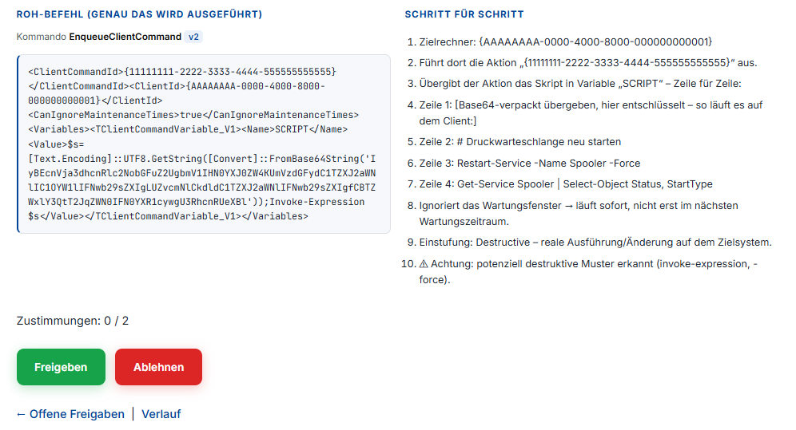

<div align="center">

# ACMP-MCP-Server

**Aagon ACMP für jede KI – mit Vier-Augen-Freigabe, direkt auf eurem ACMP-Server.**

[](#kompatibilität)
[](https://modelcontextprotocol.io/)
[](#tools)
[](#so-sieht-die-freigabe-aus)
<br>
[](#kompatibilität)
[](#kompatibilität)
[](LICENSE)
[](https://github.com/Herzog-GmbH/acmp-mcp/commits/main)

[Schnellstart](#schnellstart) · [Client anbinden](#client-anbinden) · [Tools](#tools) · [Sicherheit](#sicherheit) · [Dokumentation](#dokumentation)

</div>

> [!NOTE]
> **English:** MCP server for Aagon ACMP's Public API, with a built-in four-eyes approval gate for write/execute/delete actions. Runs as a single Windows EXE on the ACMP server and works with any MCP client. Docs are in German because ACMP's user base is mostly DACH; issues in English are welcome.

Ein [MCP](https://modelcontextprotocol.io/)-Server für die **ACMP Public API** ([Aagon Client Management Platform](https://www.aagon.com/)). Ihr fragt in normaler Sprache, zum Beispiel „Welche Rechner waren seit 30 Tagen offline?“, und die KI holt sich die Antwort direkt aus ACMP.

## Auf einen Blick

- **Jeder MCP-Client:** Claude, ChatGPT/Codex, GitHub Copilot, Gemini, Cursor …
- **Breite Abdeckung:** Clients, Container, Jobs/Client Commands, Tickets, Assets, Inventar, Schwachstellen und Stammdaten.
- **Vier-Augen-Freigabe:** Lesen läuft sofort. Alles, was etwas verändert, ausführt oder löscht, läuft erst, wenn ein Mensch auf der Freigabe-Seite zustimmt, bei kritischen Aktionen zwei verschiedene Personen.
- **Pro Bediener:** eigener API-Key und optional eigene ACMP-Identität. ACMP prüft dann die echten Rechte der Person.
- **Eine EXE, keine Cloud:** läuft direkt auf dem ACMP-Server. Kein IIS, kein .NET-SDK.
- **Optional:** Client Commands anlegen, freigeben und einsortieren sowie den **Kiosk** pflegen, direkt in der ACMP-Datenbank. Standardmäßig aus.
- **Fertige Vorlagen:** In der [ACMP CTL](https://herzog-gmbh.github.io/acmp-ctl/) (Community Template Library) liegen Client-Command-Vorlagen mit jedem Schritt im Klartext. `acmp_lib_install` legt sie als Entwurf in eurer Console an.

## Kompatibilität

| | Getestet bzw. vorausgesetzt |
|---|---|
| **ACMP** | 6.9 und 6.10, mit AESB/SICS und freigeschalteter Public API |
| **CC-Writer / Kiosk-Writer** | ACMP 6.10. Bei Abweichungen, etwa nach einem ACMP-Update, sperrt die Vorprüfung das Schreiben |
| **Server** | Windows Server mit .NET Framework 4.8, Admin-Rechte auf dem ACMP-Server |
| **MCP** | Streamable HTTP (JSON-RPC 2.0), Protokollversion `2025-06-18` |
| **KI-Clients** | Vorlagen für Claude Code, Claude Desktop (auch als Erweiterung `.mcpb`), Codex CLI, VS Code/GitHub Copilot, Cursor und Gemini CLI in [`docs/CLIENTS.md`](docs/CLIENTS.md) |

## Schnellstart

### A) Von eurer KI einrichten lassen

Auf dem **ACMP-Server** das Repo klonen oder als ZIP entpacken. Dort einen KI-Agenten starten, der Befehle ausführen kann (Claude Code, Codex CLI, GitHub Copilot im Agent-Modus, Gemini CLI, Cursor o. Ä.), und eingeben:

```text
Richte diesen ACMP-MCP-Server auf diesem Rechner ein. Folge AGENTS.md Schritt für Schritt,
erkläre mir jeden Admin-Schritt, bevor ich ihn ausführe, und frag mich nie nach Passwörtern
oder API-Keys im Chat.
```

[`AGENTS.md`](AGENTS.md) enthält den kompletten Ablauf: Prüfung, Installation, Ersteinrichtung, LAN-Freigabe, Client-Anbindung und Fehlersuche. Die meisten Agenten lesen die Datei von selbst. Für Claude Code (`CLAUDE.md`), Gemini CLI (`GEMINI.md`) und GitHub Copilot (`.github/copilot-instructions.md`) liegen Verweise bei.

### B) Von Hand: der Assistent im Terminal

Auf dem ACMP-Server eine PowerShell öffnen, ins Repo wechseln und starten. Fehlen Admin-Rechte, startet sich das Skript nach einer Windows-Abfrage (UAC) selbst neu:

```powershell
.\install.ps1
```

Zum Schluss zeigt der Assistent **euren API-Key und die Links zur Freigabe-Seite, zum Dashboard und zum Onboarding**, auf Wunsch kopiert er den Key in die Zwischenablage. Danach fragt er nach eurem KI-Client und zeigt die fertige Konfiguration dafür.

<details>
<summary><b>Was der Assistent in 9 Schritten macht</b></summary>

Bei jedem Schritt erklärt er, was passiert, und schlägt Werte vor (Enter übernimmt):

1. **Prüft die Voraussetzungen** (AESB SICS, Port 3950, .NET, freier Port). Bei einem Fehler sagt er, was zu tun ist.
2. **Fragt nach der Public API** in der ACMP-Konsole und zeigt den Klickpfad.
3. **Installiert und baut** nach `C:\ProgramData\AcmpMcp`. Config, Secrets und Logs sind nur für Administratoren und SYSTEM lesbar.
4. **Fragt den SICS-Benutzer ab.** Das Passwort wird verdeckt eingegeben.
5. **Richtet den Dienst ein und prüft die Anmeldung an ACMP.** Klappt sie nicht, fragt er die Zugangsdaten erneut ab.
6. **Legt dich als ersten Administrator und Freigeber an.**
7. **Verknüpft deine eigene ACMP-Identität**, wenn du das möchtest. Dann prüft ACMP deine echten Rechte.
8. **Optionale Funktionen:** Ad-hoc-PowerShell, DB-Reports, E-Mail-Benachrichtigung.
9. **Netzwerk:** schlägt LAN-IP und Subnetz vor und gibt den Server für die Admin-PCs frei.

Die Klicks in der ACMP-Konsole beschreibt [`docs/ACMP-VORBEREITUNG.md`](docs/ACMP-VORBEREITUNG.md), zum Beispiel für die Client-Command-Vorlage der Ad-hoc-PowerShell.

</details>

<details>
<summary><b>Weitere Befehle: Kolleg:innen anlegen, aktualisieren, deinstallieren</b></summary>

Weitere Kolleg:innen legt ihr im Terminal an oder im Browser über `/onboarding`:

```powershell
cd C:\ProgramData\AcmpMcp
.\add-user.ps1
```

| Befehl | Zweck |
|---|---|
| `.\install.ps1 -CheckOnly` | nur prüfen, nichts verändern (kein Admin nötig) |
| `.\install.ps1` | erneut ausführen = aktualisieren. Konfiguration und Bediener bleiben erhalten, Erledigtes wird übersprungen |
| `.\install.ps1 -NonInteractive -SicsUser … -AdminName … -AdminEmail …` | ohne Rückfragen, z. B. für Skripte. Das Passwort kommt aus `$env:ACMP_SICS_PASSWORD` |
| `.\set-network-admin.ps1 -BindAddress <IP>` | Netzwerk später ändern |
| `.\uninstall-admin.ps1` | Dienst und Firewall-Regel entfernen |

</details>

## Client anbinden

Jeder MCP-Client, der **Streamable HTTP** mit eigenem Header kann, verbindet sich direkt:

| | |
|---|---|
| **URL** | `http://<HOST>:8765/` |
| **Header** | `Authorization: Bearer <KEY>` (persönlicher API-Key von der Setup- bzw. Onboarding-Seite) |

Zum Beispiel Claude Code:

```bash
claude mcp add --transport http acmp http://<HOST>:8765/ --header "Authorization: Bearer <KEY>" --scope user
```

**Claude Desktop:** `acmp-mcp-<version>.mcpb` aus den [Releases](https://github.com/Herzog-GmbH/acmp-mcp/releases) per Doppelklick installieren, dann Server-Adresse und API-Key in den Einstellungen der Erweiterung eintragen.

Fertige Konfigurationen für alle gängigen Clients stehen in [`docs/CLIENTS.md`](docs/CLIENTS.md). Clients, die nur lokale (stdio) Server kennen, binden ihr über die Brücke `mcp-remote` an.

## Funktionsweise



<details>
<summary><b>Technische Details</b></summary>

- Der Server verbindet sich über Aagons eigene Client-DLLs (`Aagon.Sis.Sics.*`, sind im ACMP-Setup schon vorhanden) mit SICS/AESB (`wss://127.0.0.1:3950`). Protokoll, Verschlüsselung und Anmeldung sind dadurch dieselben wie in Aagons eigenen Werkzeugen.
- Er sendet ICQL-Kommandos an ACMP. Den Routing-Key ermittelt er selbst, den Virtual Router liest er aus der Config (Standard `VCMN`).
- Die Kommandos stehen als MCP-Tools über JSON-RPC 2.0/HTTP bereit (eigener `TcpListener`, keine URL-ACL nötig).
- **Pro-User:** Jeder Bediener hat einen eigenen API-Key und optional eine eigene ACMP-Identität. ACMP prüft dann dessen echte Rechte (`GetOwnUserRights`).
- **Vier-Augen-Freigabe:** Schreib-, Ausführ- und Löschaufrufe laufen nicht sofort, sondern werden als Antrag eingefroren. Erst wenn 1 Person (Write) bzw. 2 verschiedene Personen (Destructive) auf der Weboberfläche zustimmen, startet der eigentliche ACMP-Aufruf. Die Zustimmung läuft also außerhalb des LLM.

</details>

## So sieht die Freigabe aus

Fordert die KI einen Schreib-, Ausführ- oder Löschbefehl an, landet er als Antrag auf der Freigabe-Seite. Es wird nichts ausgeführt, bis genug **verschiedene** Personen zugestimmt haben. Die Bilder zeigen eine Demo-Instanz mit erfundenen Daten.



<details>
<summary><b>Detailansicht und Zustimmung</b></summary>

Die Detailansicht zeigt die angegebene Absicht, Antragsteller und Zielrechner sowie das Skript **im Klartext**, genau so, wie es auf dem Client läuft:



Darunter stehen der Roh-Befehl an ACMP, eine Schritt-für-Schritt-Erklärung mit Warnhinweisen und die Buttons für die Zustimmung:



</details>

**Ein Beispiel im Ablauf:**

1. Ihr schreibt: „Auf PC-0815 ist die Platte voll, räum den Windows-Temp-Ordner auf.“
2. Die KI sucht den Rechner (`acmp_get_client_id`), prüft die Laufwerke (`acmp_low_disk_space`) und stellt einen PowerShell-Antrag (`acmp_run_powershell`).
3. Auf der Freigabe-Seite sehen zwei Kollegen das Skript im Klartext und klicken „Freigeben“.
4. Erst dann läuft das Skript auf dem Client, und die KI meldet das Ergebnis.

## Tools

118 Tools in 10 Bereichen. Ein Klick auf einen Bereich zeigt alle Tools mit ihrer Freigabestufe:

🟢 läuft sofort (nur lesen) · 🟡 Freigabe durch 1 Person · 🔴 Freigabe durch 2 verschiedene Personen

Die Stufen sind die Standardwerte aus dem Code und lassen sich pro Tool unter `/settings` anpassen. Manche Tools brauchen eine optionale Funktion: *(DB)* die Datenbank-Anbindung (`db.connectionString`, nur lesend), *(PS)* die Client-Command-Vorlage (`runPowershell.clientCommandId`), *(CW)* den CC-Writer (`ccWriter`), *(KW)* den Kiosk-Writer (`kioskWriter`). Die aktuelle Liste liefert `tools/list`. Jedes Tool akzeptiert optional `format: "json"`.

<details>
<summary><b>System &amp; Allgemein</b> · 11 Tools · Server-Info, eigene Rechte, <code>acmp_call</code> für jedes der 167 API-Kommandos</summary>

| | Tool | Zweck |
|---|---|---|
| 🟢 | `acmp_server_info` | ACMP-Version und Serverdaten |
| 🟢 | `acmp_whoami` | mit welchem ACMP-Benutzer und welchen Rechten man arbeitet |
| 🟢 | `acmp_logout` | Verbindung neu aufbauen, z. B. nach einem Token-Wechsel |
| 🟢 | `acmp_list_commands`, `acmp_describe` | alle 167 Public-API-Kommandos auflisten und mit Parametern erklären |
| 🟡 | `acmp_call` | jedes API-Kommando ohne eigenes Tool. Lesende Kommandos laufen sofort, schreibende brauchen eine Freigabe |
| 🟢 | `acmp_approval_status` | Stand eines Freigabe-Antrags |
| 🟢 | `acmp_discover_tables` *(DB)* | Tabellen in der ACMP-Datenbank suchen („Was hat mit BitLocker zu tun?“) |
| 🟢 | `acmp_db_columns` *(DB)* | Spalten einer Tabelle oder View |
| 🟢 | `acmp_db_script_rows`, `acmp_db_script_blob` *(beide DB)* | Zeilen und Binärspalten der Client-Command-, Kiosk- und File-Repository-Tabellen (nur diese) |

</details>

<details>
<summary><b>Clients &amp; Inventar</b> · 12 Tools · „Wer war zuletzt an PC-0815?“, Hardware, Offline-Rechner, Plattenplatz</summary>

| | Tool | Zweck |
|---|---|---|
| 🟢 | `acmp_get_clients`, `acmp_get_client_id`, `acmp_client_info` *(DB)* | Rechner auflisten, per Name oder MAC finden, Steckbrief mit IP, MAC und Agent-Version |
| 🟢 | `acmp_get_os_info` | Betriebssystem und zuletzt angemeldeter Benutzer („Wer war zuletzt an PC-0815?“) |
| 🟢 | `acmp_get_hardware`, `acmp_hardware_profile` *(DB)* | CPU, RAM, Platten, Dienste, Hersteller, Modell, Seriennummer |
| 🟢 | `acmp_offline_clients` *(DB)* | Rechner ohne Kontakt seit X Tagen |
| 🟢 | `acmp_agent_versions` *(DB)* | Verteilung der Agent-Versionen |
| 🟢 | `acmp_low_disk_space` *(DB)* | Laufwerke mit wenig freiem Platz |
| 🟢 | `acmp_read_registry`, `acmp_read_registry_result` *(beide PS)* | einen Registry-Wert vom Client lesen (festes Lese-Skript) |
| 🟢 | `acmp_db_client_attributes` *(DB)* | benutzerdefinierte Felder eines Clients |

</details>

<details>
<summary><b>Software &amp; Sicherheit</b> · 12 Tools · CVEs, fehlende Updates, Defender, BitLocker, Lizenzen</summary>

| | Tool | Zweck |
|---|---|---|
| 🟢 | `acmp_get_software`, `acmp_software_inventory` *(DB)*, `acmp_software_search` *(DB)* | installierte Software je Rechner und Suche („Wo ist 7-Zip drauf?“) |
| 🟢 | `acmp_outdated_software` *(DB)* | veraltete Software |
| 🟢 | `acmp_missing_updates`, `acmp_failed_updates` *(beide DB)* | fehlende und fehlgeschlagene Windows-Updates |
| 🟢 | `acmp_vulnerabilities`, `acmp_oval_scan_status` *(beide DB)* | Schwachstellen (CVEs) mit Score und Zeitpunkt des letzten Scans |
| 🟢 | `acmp_defender_health` *(DB)* | Defender-Status („Wo ist der Echtzeitschutz aus?“) |
| 🟢 | `acmp_bitlocker_status` *(DB)* | BitLocker-Status je Laufwerk |
| 🟢 | `acmp_get_licenses`, `acmp_license_compliance` *(DB)* | Lizenzen mit Über- und Unterdeckung |

</details>

<details>
<summary><b>Jobs &amp; Ausführen</b> · 6 Tools · Client Command starten, PowerShell als SYSTEM 🔴</summary>

| | Tool | Zweck |
|---|---|---|
| 🟢 | `acmp_get_client_commands` | verfügbare Client Commands |
| 🟢 | `acmp_get_jobs`, `acmp_job_results` *(DB)*, `acmp_script_history` *(DB)* | was auf einem Rechner gelaufen ist und mit welchem Ergebnis |
| 🟡 | `acmp_enqueue_client_command` | einen vorhandenen Client Command starten |
| 🔴 | `acmp_run_powershell` *(PS)* | beliebiges PowerShell als SYSTEM auf einem Client |

</details>

<details>
<summary><b>Client Commands</b> · 15 Tools · <i>optional</i> · Entwurf anlegen, neue Version, freigeben, einsortieren</summary>

Die Public API kann Client Commands nur starten, nicht anlegen. Diese Tools lesen sie deshalb direkt aus der ACMP-Datenbank, legen auf Wunsch **Entwürfe** an, geben eigene Entwürfe frei und sortieren Commands in Ordner. Das Schreiben ist von Aagon nicht vorgesehen und deshalb standardmäßig aus. Einrichtung: [`docs/ACMP-VORBEREITUNG.md`](docs/ACMP-VORBEREITUNG.md#client-commands-direkt-schreiben-cc-writer) → „Client Commands direkt schreiben“.

| | Tool | Zweck |
|---|---|---|
| 🟢 | `acmp_cc_decode` *(DB)* | Schritte eines Client Commands im Klartext, als Eingabe für einen neuen Entwurf verwendbar. Kennwörter werden maskiert |
| 🟢 | `acmp_cc_catalog` *(DB)* | welche Schrittarten in euren Commands vorkommen, mit Feldern und Beispielen |
| 🟢 | `acmp_cc_folders` *(DB)* | Ordnerbaum der Client Commands, auf Wunsch mit den Commands je Ordner |
| 🟢 | `acmp_cc_writer_status` *(DB)* | Stand des Writers und Ergebnis der Kompatibilitätsprüfung |
| 🟡 | `acmp_cc_create_draft`, `acmp_cc_update_draft` *(CW)* | Entwurf anlegen oder seine Schritte ersetzen (vorher automatische Sicherung) |
| 🟡 | `acmp_cc_restore_draft` *(CW)* | Entwurf auf eine Sicherung zurücksetzen |
| 🟡 | `acmp_cc_add_file`, `acmp_cc_remove_file` *(CW)* | Installationsdatei an einen Entwurf hängen oder entfernen (File Repository, mit SHA-256) |
| 🟡 | `acmp_cc_new_version` *(CW)* | neue Version eines vorhandenen Commands als Entwurf, auch von freigegebenen und fremden (wie „Speichern“ in der Konsole). Die freigegebene Version läuft weiter, bis die neue freigegeben ist (`acmp_cc_release` oder Konsole). Läuft **immer** über die Freigabe-Seite, die Vorschau zeigt die Änderungen gegenüber der freigegebenen Version |
| 🟡 | `acmp_cc_release` *(CW)* | Entwürfe freigeben wie in der Konsole, mehrere in einem Auftrag: eigene neue Commands und neue Versionen aus `acmp_cc_new_version` (die bisher freigegebene Version wird dabei abgelöst). Läuft **immer** über die Freigabe-Seite, auch wenn sie sonst abgeschaltet ist |
| 🟡 | `acmp_cc_move` *(CW)* | viele Commands in einem Auftrag in andere Ordner verschieben, mit `undo` |
| 🟡 | `acmp_cc_add_folder`, `acmp_cc_update_folder` *(CW)* | Ordner anlegen (Rechte wie der Elternordner), umbenennen oder verschieben |
| 🟡 | `acmp_lib_install` *(DB, CW)* | Vorlage aus der [ACMP CTL](https://herzog-gmbh.github.io/acmp-ctl/) (Community Template Library) oder einem eigenen Vorlagen-Ordner als Entwurf installieren. Mit `dryRun` 🟢 auch ohne Writer |

Der Writer ändert nur eigene Entwürfe im erlaubten Ordner und nur für erlaubte Bediener. Vorhandene Commands fasst er nur über `acmp_cc_new_version` an: als neue Version, nie in Aagon-Standardordnern, Schritt-IDs und gespeicherte Kennwörter bleiben erhalten, einen fremden Entwurf überschreibt er nur auf ausdrücklichen Wunsch (mit Sicherung). Jede Schreibaktion läuft über die Freigabe-Seite, die Vorschau zeigt jeden Schritt mit seinen Feldern.

Vor dem Schreiben prüft der Server die ACMP-Version, Tabellen, Trigger und Rechte des Schreib-Logins. Er packt außerdem die 50 neuesten Commands probeweise aus und wieder ein. Weicht etwas ab, etwa nach einem ACMP-Update, schreibt er nichts. Freigeben geht für eigene Entwürfe und für Versionen, die zuletzt der MCP gespeichert hat, und nur, wenn der Inhalt seit der Anfrage gleich geblieben ist. Folgeversionen mit geänderten Dateien gibt er nicht frei, die bleiben Sache der Konsole. Platzhalter wie „HIER … EINTRAGEN“ sperren die Freigabe. Getestet mit ACMP 6.10.

</details>

<details>
<summary><b>Kiosk</b> · 12 Tools · <i>optional</i> · Einträge, Ordner, Sichtbarkeit, Icons</summary>

Auch den ACMP-Kiosk kann die Public API nicht pflegen. Diese Tools lesen und schreiben ihn deshalb direkt in der ACMP-Datenbank. Auch das ist standardmäßig aus. Einrichtung: [`docs/ACMP-VORBEREITUNG.md`](docs/ACMP-VORBEREITUNG.md#kiosk-pflegen-kiosk-writer) → „Kiosk pflegen“.

| | Tool | Zweck |
|---|---|---|
| 🟢 | `acmp_kiosk_tree` *(DB)* | Kiosk-Ordner, Einträge und Sichtbarkeitsfilter im Klartext; mit `status: true` das Ergebnis der Vorprüfung |
| 🟢 | `acmp_kiosk_images` *(DB)* | vorhandene Icons und Bilddateien in den erlaubten Quellen, mit Vorschau im Chat |
| 🟡 | `acmp_kiosk_add_item` *(KW)* | Client Command oder Managed Software als Kiosk-Eintrag anlegen, mit Icon und Sichtbarkeitsfilter (AD-Gruppe, OU, Benutzer, Container, Stammdaten …) |
| 🟡 | `acmp_kiosk_update_items` *(KW)* | viele Einträge in einem Auftrag verschieben, umbenennen, Beschreibung, Icon oder Filter ändern |
| 🟡 | `acmp_kiosk_set_filter`, `acmp_kiosk_remove_item` *(KW)* | Sichtbarkeit eines Eintrags ändern, Eintrag entfernen |
| 🟡 | `acmp_kiosk_add_group`, `acmp_kiosk_update_group` *(KW)* | Kiosk-Ordner anlegen, umbenennen (DE/EN), Icon und Filter ändern |
| 🟡 | `acmp_kiosk_add_image`, `acmp_kiosk_set_image`, `acmp_kiosk_remove_image` *(KW)* | Icon hochladen (PNG, JPG, ICO, SVG), setzen, ungenutztes eigenes Icon entfernen |
| 🟡 | `acmp_kiosk_restore` *(KW)* | eine Kiosk-Änderung aus der automatischen Sicherung zurückholen |

Geschrieben wird nur in Kiosk-Ordnern, die ihr freigebt, und in Ordnern, die der MCP selbst angelegt hat. Vor jeder Änderung sichert der Server den alten Stand. Die Anwender sehen Änderungen nach „Aktualisieren“ im Kiosk.

</details>

<details>
<summary><b>Container</b> · 5 Tools · Mitglieder lesen, anlegen, ändern, löschen 🔴</summary>

| | Tool | Zweck |
|---|---|---|
| 🟢 | `acmp_container_members`, `acmp_client_containers` *(beide DB)* | Rechner in einem Container und Container eines Rechners |
| 🟡 | `acmp_create_container`, `acmp_save_containers` | Container anlegen oder ändern |
| 🔴 | `acmp_delete_containers` | Container löschen |

</details>

<details>
<summary><b>Assets &amp; Stammdaten</b> · 25 Tools · Assets verleihen, Kontakte, Standorte, Verträge</summary>

| | Tool | Zweck |
|---|---|---|
| 🟢 | `acmp_get_asset_list`, `acmp_get_asset_types` | Assets und Asset-Typen |
| 🟡 | `acmp_create_asset`, `acmp_update_asset` | Asset anlegen oder ändern |
| 🟡 | `acmp_lend_asset`, `acmp_return_asset` | Asset verleihen oder zurücknehmen |
| 🟢 | `acmp_get_contacts`, `_companies`, `_locations`, `_departments`, `_cost_centers` | Stammdaten lesen |
| 🟡 | `acmp_create_*`, `acmp_update_*` für `contact`, `company`, `location`, `department` | Stammdaten anlegen oder ändern |
| 🟢 | `acmp_get_contracts`, `acmp_contracts_expiring` *(DB)* | Verträge und bald auslaufende Verträge |
| 🟢 | `acmp_get_custom_fields`, `_custom_field_list`, `_master_data_settings`, `_app_settings` | Zusatzfelder und Einstellungen lesen |

</details>

<details>
<summary><b>Helpdesk</b> · 18 Tools · „Mach ein Ticket: Drucker 2. OG druckt nicht.“</summary>

| | Tool | Zweck |
|---|---|---|
| 🟢 | `acmp_get_tickets`, `acmp_get_ticket`, `acmp_tickets_by_query` | Tickets lesen, auch über gespeicherte Abfragen |
| 🟢 | `acmp_get_ticket_comments`, `_worktime`, `_costs`, `acmp_get_linked_tickets` | Verlauf, Zeiten, Kosten, Verknüpfungen |
| 🟢 | `acmp_helpdesk_settings`, `acmp_get_assignees`, `_ticket_templates`, `_ticket_categories`, `_ticket_resolutions`, `_queries` | Helpdesk-Einstellungen |
| 🟡 | `acmp_create_ticket` | Ticket anlegen („Mach ein Ticket: Drucker 2. OG druckt nicht.“) |
| 🟡 | `acmp_update_ticket` | Bearbeiter oder Priorität ändern |
| 🟡 | `acmp_close_ticket`, `acmp_reopen_ticket` | Ticket schließen oder wieder öffnen |
| 🟡 | `acmp_add_ticket_comment` | Kommentar ergänzen |

</details>

<details>
<summary><b>Fernwartung</b> · 2 Tools · TeamViewer-ID und Verbindungslink</summary>

| | Tool | Zweck |
|---|---|---|
| 🟢 | `acmp_teamviewer_ids` *(DB)* | TeamViewer-IDs aller Clients |
| 🟢 | `acmp_teamviewer_connect` *(DB)* | TeamViewer-Link zu einem Rechner, Suche auch per Benutzername |

</details>

Beispiel-Prompts stehen in [`docs/USAGE.md`](docs/USAGE.md). Neue native Kommandos ergänzt ihr deklarativ in `api-tools.json`, neue SQL-Reports in `db-tools.json`. Beides braucht kein Neu-Kompilieren.

## Weboberfläche

| Seite | Zweck |
|---|---|
| `/dashboard` | Übersicht: offene, ausgeführte und abgelehnte Anträge |
| `/approvals` | offene Freigaben prüfen und zustimmen |
| `/history` | Verlauf aller Anträge |
| `/settings` | Freigabe-Schwellwerte pro Tool |
| `/onboarding` | weitere Bediener anlegen |
| `/changelog` | Patchverlauf des Servers |
| `/setup` | Ersteinrichtung, nur aktiv, solange es keinen Freigeber gibt |

Die Anmeldung läuft über ein eigenes Token pro Freigeber und ist **unabhängig** vom ACMP- oder MCP-Key: Ein abgeflossener API-Key gibt also keine Freigaberechte.

## Konfiguration

`config.example.json` ist kommentiert (`_hinweis`-Felder). `install.ps1` erzeugt daraus `config.local.json`.

<details>
<summary><b>Wichtige Schlüssel</b></summary>

| Schlüssel | Bedeutung |
|---|---|
| `sics.username` / `password` | SICS-/AESB-Basisverbindung |
| `sics.virtualRouter` / `wssPort` | Standard `VCMN` / `3950` |
| `mcp.bindAddress` / `httpPort` | Standard `127.0.0.1` / `8765`. LAN-Zugriff über `set-network-admin.ps1` |
| `approval.*` | Vier-Augen-Freigabe, Schwellwerte, SMTP-Benachrichtigung |
| `runPowershell.clientCommandId` | optional, aktiviert `acmp_run_powershell` / `acmp_read_registry` |
| `db.connectionString` | optional, aktiviert die DB-Report-Tools |
| `helpdesk.createdStateId` | optional, Ticketstatus für neue Tickets |
| `ccWriter.*` | optional, standardmäßig aus: Client Commands als Entwurf schreiben, freigeben, einsortieren. Einrichten mit `setup-cc-writer.ps1`, weitere Bediener mit `setup-cc-writer.ps1 -AddRequester <name>` |
| `kioskWriter.*` | optional, standardmäßig aus: Kiosk pflegen. Setzt den CC-Writer voraus (gleicher SQL-Login). Einrichten mit `setup-kiosk-writer.ps1` |
| `ctl.sources` | optional, Quellen für `acmp_lib_install`. Standard: Ordner `ctl` im Installationsordner, dann das Repo [`Herzog-GmbH/acmp-ctl`](https://github.com/Herzog-GmbH/acmp-ctl) |

</details>

## Sicherheit

> [!WARNING]
> Der Server gewährt vollen ACMP-Zugriff bis hin zur **Befehlsausführung auf allen Endgeräten**. Behandelt jeden API-Key wie ein Admin-Passwort.

- **Kein TLS eingebaut.** Der Server lauscht standardmäßig nur auf `127.0.0.1` und verweigert LAN-Betrieb ohne API-Key. Im LAN beschränkt ihr per Firewall die Quell-Subnetze. Über Netzgrenzen hinweg gehört ein TLS-Proxy oder VPN davor.
- `install.ps1` beschränkt den Installationsordner auf Administratoren und SYSTEM, denn dort liegen Zugangsdaten.
- Bediener-Passwörter werden nie gespeichert: `acmp-token-setup.exe` speichert nur einen DPAPI-verschlüsselten Token (`LocalMachine`).
- `/regresult` (Rückkanal für `acmp_read_registry`) ist bewusst ohne Key erreichbar, weil der Client den Key nicht kennt. Er nimmt nur Ergebnisse zu offenen, nicht ratbaren Tokens an.
- Sicherheitslücken bitte **nicht** als öffentliches Issue melden, sondern wie in [`SECURITY.md`](SECURITY.md) beschrieben.

<details>
<summary><b>CC-Writer und Kiosk-Writer</b></summary>

- Der optionale CC-Writer schreibt mit einem **eigenen SQL-Login** mit genau den nötigen Rechten (`grant-cc-writer.sql`), nie mit dem Lese-Zugang. In `SYS_SCRIPTS` darf er nichts löschen. Er legt nur Entwürfe an, sichert vor jeder Änderung und ändert oder gibt nur Commands frei, die er selbst angelegt hat. Fremde Commands ändert er nur als neue Version (`acmp_cc_new_version`, immer mit Freigabe-Anfrage) und verschiebt sie auf Wunsch. Löschen darf er nichts.
- Der optionale Kiosk-Writer nutzt denselben Login mit den Rechten aus `grant-kiosk-writer.sql`. Ordner löschen darf er nicht, und er schreibt nur in freigegebene Kiosk-Ordner.
- Wichtig für das Onboarding: Der SQL-Login gehört dem **Server**, nicht den Bedienern. Wer die Schreib-Tools beantragen darf, steht in `ccWriter.allowedRequesters` (`add-user.ps1` fragt danach, für Bediener aus `/onboarding`: `setup-cc-writer.ps1 -AddRequester <name>`). Zustimmen muss trotzdem ein Freigeber. Die ACMP-Rechte der Person prüft ACMP bei diesen Tools **nicht**, weil sie an der Public API vorbei in die Datenbank schreiben.

</details>

## Dokumentation

| Datei | Inhalt |
|---|---|
| [`AGENTS.md`](AGENTS.md) | Einrichtungs-Ablauf für KI-Agenten, inkl. Fehlersuche |
| [`docs/ACMP-VORBEREITUNG.md`](docs/ACMP-VORBEREITUNG.md) | Klicks in der ACMP-Konsole: Public API, SICS-Benutzer, optionale Funktionen |
| [`docs/CLIENTS.md`](docs/CLIENTS.md) | Konfiguration für alle gängigen MCP-Clients |
| [`docs/USAGE.md`](docs/USAGE.md) | Cheat-Sheet mit Beispiel-Prompts für Anwender |
| [`config.example.json`](config.example.json) | kommentierte Beispiel-Konfiguration |
| [`SECURITY.md`](SECURITY.md) | Sicherheitslücken vertraulich melden |

## Mitmachen

Issues und Pull Requests sind willkommen. Bitte in Issues **keine** Logs mit Hostnamen, IPs, Benutzernamen, Keys oder Tokens posten, sondern vorher schwärzen.

## Lizenz

[MIT](LICENSE). Kein offizielles Produkt der Aagon GmbH. ACMP und AESB sind Marken der Aagon GmbH.
